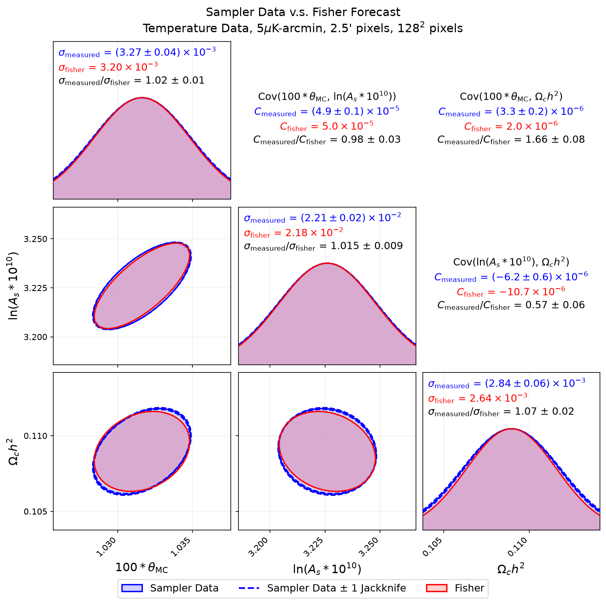

# Summary

Weak gravitational lensing by large-scale structure distorts the cosmic microwave background (CMB), and isolating the unlensed CMB from the lensing potential $\phi$ that deflects it is an important part of extracting cosmological information from CMB maps. CMBLensing.py is a Python port of CMBLensing.jl [@CMBLensing.jl], a Julia package that simulates lensed CMB maps, computes joint maximum a posteriori (MAP) estimates of the unlensed CMB and $\phi$, and samples cosmological parameters. CMBLensing.py is built on JAX [@jax2018github], so it is just-in-time (JIT) compiled, differentiable, and runs on both CPU and GPU. It reproduces the core functionality of the Julia package and has been thoroughly tested for regressions. We have also extended the Gibbs sampler, which originally inferred the tensor-to-scalar ratio $r$ and the lensing amplitude $A_\phi$ [@Millea_2020], to jointly sample any subset of five of the $\Lambda$CDM parameters {$100*\theta_{MC}$, $\ln(A_s*10^{10})$, $n_s$, $\Omega_b h^2$, $\Omega_c h^2$}, with the optical depth to reionization $\tau$ held fixed.

# Statement of Need

CMB analyses increasingly combine physical forward models with differentiable emulators and gradient-based samplers, and much of this tooling is now written in JAX [@Zhou_2026; @Chanial_2026]. A Julia implementation cannot take part in such pipelines: it cannot be traced by `jax.jit` or differentiated by `jax.grad`, and calling it from Python through `juliacall` [@PythonCall.jl] adds Julia compilation latency at the start of every session and type conversions at every call. CMBLensing.py removes these barriers by providing the same lensing forward model, MAP estimator, and sampler natively in JAX. It is intended for researchers performing field-level CMB lensing reconstruction, delensing, or cosmological inference. 

# State of the Field

CMBLensing.jl has been publicly available since 2017 and has been used in a number of research applications such as [@Millea_2021], which inferred $A_\phi$ from SPTpol polarization data. Other public tools address similar problems: plancklens [@plancklens] provides quadratic-estimator lensing reconstruction, LensIt [@Carron_2017] and delensalot [@delensalot] perform iterative MAP lensing reconstruction, lenspyx [@lenspyx] offers curved-sky lensing methods, and Flinch [@crespi2025flinchdifferentiableframeworkfieldlevel] performs field-level parameter inference. CMBLensing.py differs from these packages in a few different ways. First, its forward model and posterior are automatically differentiable and run natively on GPU, whereas plancklens, LensIt, lenspyx, and delensalot are not automatically differentiable. Second, because it is written in JAX, it composes directly with other JAX projects: CMBLensing.jl and Flinch are differentiable but are written in Julia, which makes interfacing with Python packages difficult. Third, it jointly samples $\Lambda$CDM parameters together with the unlensed CMB field $f$ and lensing potential $\phi$, whereas the CMBLensing.jl sampler pairs $f$ and $\phi$ only with $r$ and $A_\phi$. Fourth, unlike Flinch, it includes lensing in the forward model and samples $\phi$. 

# Software Design

CMBLensing.py is organized around flat-sky field and operator types. Maps are `Field` objects (`FlatS0` for temperature, `FlatS2` for polarization, `FlatS02` for both), and covariances, beams, and masks are Fourier-space operators (`DiagonalScalar`, `DiagonalEB`, `BlockTEB`). We use `flax.struct` dataclasses [@flax2020github], so they can easily pass through `jax.jit`, `jax.grad`, and `jax.vmap`. Arithmetic is overloaded per type, so the same lensing, Wiener-filter, and likelihood code serves all three polarization configurations without branching.

Each module was ported and validated against CMBLensing.jl on identical inputs. A pytest [@pytest] suite checks that the Python outputs agree with cached Julia results to numerical precision. In addition to checking accuracy, we also compared the runtime of the MAP estimator `map_joint` between implementations. On 4 CPU cores with temperature-plus-polarization data, the compiled Python version runs 1.4–2x slower than Julia for maps at or below $512 \times 512$ pixels and 3.8x slower at $1024 \times 1024$. The slowdown comes mainly from the line search optimizing the $\phi$ step. We find that Brent's method in CMBLensing.jl converges in markedly fewer evaluations than the standard Python line searches available to us.

The Python port's parameter sampler keeps the same Gibbs structure of [@Millea_2020] and replaces its $(r, A_\phi)$ step with a Metropolis-within-Gibbs update of each sampled $\Lambda$CDM parameter. The pseudocode below describes how the algorithm draws parameter samples for an input data map $d$:

| **Initialize** the starting guesses for the lensing potential $\phi$ and the $\Lambda$CDM parameters $\vec{\theta}$
| **for** $k = 1, \ldots, N_\mathrm{steps}$ **do**
|     Sample $f \sim P(f \mid d, \phi, \vec{\theta})$ via Hoffman-Ribak
|     Sample $\phi \sim P(\phi \mid d, f, \vec{\theta})$ via Hamiltonian Monte Carlo
|     **for** each $\theta_i \in \vec{\theta}$ **do**
|         Sample $\theta_i \sim P(\theta_i \mid d, f, \phi, \{\theta_j\}_{j \neq i})$ via 1-D Metropolis-Hastings
|     **end for**
| **end for**

Because every $\theta$ proposal needs new unlensed spectra, and calling CAMB at each step would dominate the runtime, we precompute CAMB spectra on a five-dimensional grid over {$H_0, \ln(A_s*10^{10}), n_s, \Omega_b h^2, \Omega_c h^2$} and evaluate a tensor-product cubic spline through it. The 8 GB grid is hosted on Hugging Face and downloaded on first use.

# Research Impact Statement

The $\Lambda$CDM extension of the Gibbs sampler makes CMBLensing.py, to our knowledge, the only public code that draws joint posterior samples of the $\Lambda$CDM parameters, the unlensed CMB, and the lensing potential, with CMB lensing in the forward model. We have used the code to jointly infer $\{100*\theta_{\mathrm{MC}},\ \ln(A_s*10^{10}),\ \Omega_c h^2\}$ from synthetic lensed temperature maps of $128 \times 128$ pixels at $2.5$ arcmin/pixel resolution, with white noise levels of 2.5, 5, and 10 $\mu$K-arcmin, and $\{n_s, \Omega_bh^2\}$ fixed at their ground-truth values. We present the results here as a worked example of the pipeline.

For each noise level we ran five sub-chains on each of ten independent map realizations, starting from random points in the prior range. The full configuration and tuned sampler settings are listed in a [public data set](https://zaneblooddev.com/CMBLensing.py/results/#section=lcdm_sampling&dataset.lcdm_sampling=5uk_summer_2026&dataset.map_joint_comparison=3uk_spring_2026&dataset.phi_noise=2.5uk). After removing burn-in, each map's sub-chains were thinned by their integrated autocorrelation time and concatenated. A Gaussian posterior was fit to each map's chains, and the product of the ten posteriors represents the full posterior given all ten maps. Table 1 summarizes the results - all post-processing is automated by the package's MCMC analysis module.

| Parameter | Statistic | 2.5 μK-arcmin | 5 μK-arcmin | 10 μK-arcmin |
|---|----|---|---|---|
| $100 * \theta_{\rm MC}$ | Mean | 1.03178(9) | 1.03156(8) | 1.03070(9) |
| | Standard deviation | 0.00067(1) | 0.00102(1) | 0.00142(1) |
| | Z-score | -0.1(3) | 0.0(3) | 0.2(3) |
| $\ln(A_s * 10^{10})$ | Mean | 3.2258(7) | 3.2257(6) | 3.2262(6) |
| | Standard deviation | 0.00597(7) | 0.00688(5) | 0.00805(6) |
| | Z-score | -0.4(5) | -0.3(5) | -0.3(4) |
| $\Omega_c h^2$ | Mean | 0.10927(7) | 0.10889(7) | 0.1080(1) |
| | Standard deviation | 0.00063(1) | 0.00087(1) | 0.00141(2) |
| | Z-score | 0.0(2) | 0.2(2) | 0.3(2) |

Table: Product of the ten per-map posteriors at each noise level. Ground truths are $100*\theta_{\mathrm{MC}} = 1.031732$, $\ln(A_s*10^{10}) = 3.218387$, and $\Omega_c h^2 = 0.109381$. The Z-score is the average over maps of the truth minus a single map's mean, divided by that map's width. Parentheses give the error on the last digit, e.g. $1.0318(1) = 1.0318 \pm 0.0001$. We show the bootstrapped MCMC errors for the mean and standard deviation, and the standard error of the mean for the Z-score. Every Z-score is consistent with zero, so the sampler is unbiased at the three noise levels tested.

To judge whether the sampler performs optimally, a Fisher forecasting module predicts the width of a single map's posterior from finite differences of the delensed temperature and $\phi$ covariance matrices [@Taylor_1997]. The forecast is sensitive to how delensing is modeled: the delensed temperature covariance must come from our LenseFlow implementation [@Millea_2019] rather than CAMB's delensing software [@Lewis_2000; @Lewis_2026], and substituting the lensed or unlensed covariance can distort the forecast degeneracies and widths, possibly flipping the sign of parameter covariances. The temperature noise in the forecast is the same white noise used in the forward model, and the $\phi$ noise is the quadratic-estimator noise bias $N_0$ [@Hu_2002] with filter and response set to the unlensed temperature covariance. This represents a lower bound on the noise in $\phi$. Figure 1 compares the forecast with the chains at 5 $\mu$K-arcmin showing that the single-map widths agree to within 10% for this trial.

# Limitations

Without significantly redesigning the sampling algorithm in CMBLensing.py, we have been able to sample at most 3 $\Lambda$CDM parameters concurrently without seeing significant degeneracies and/or biases between parameters. Breaking these degeneracies typically requires moving to larger maps. One iteration of the sampler running on 4 CPU cores takes under 3 seconds for $128 \times 128$ pixel temperature maps on Caltech's Resnick HPC [@caltech_hpc] or Texas A&M's ACES cluster [@access_2023], but the runtime grows quickly with map size. The main bottleneck is the HMC step for $\phi$. Other works such as [@crespi2025flinchdifferentiableframeworkfieldlevel] report large efficiency gains from MicroCanonical Langevin Monte Carlo, and alternative samplers for $\phi$ are a natural direction for future work. 

We find that at low noise levels, the auto-correlation length of the parameter samples is very long, thus making the effective number of independent samples small and the estimate of the posterior noisy. One reason for this high correlation length is the current mixing matrix design. We adopted the mixing matrices $D$ and $G$ from [@Millea_2020] which are built from the noise covariance. As such, they work well at high noise where the parameter constraints are weak, but they lose effectiveness as the noise drops. A path to improve the autocorrelation length would be a noise independent mixing scheme, which we leave for future work.

# AI Usage Disclosure

Claude (Anthropic) was used to generate and refactor code throughout the repository, write tests and documentation, and help prepare this manuscript. All AI-generated output was reviewed by the authors before being merged, and the authors take full responsibility for the software and the manuscript.

# Acknowledgements

The computations presented here were conducted in part at the Resnick High Performance Computing Center, a facility supported by the Resnick Sustainability Institute at the California Institute of Technology.

This work also used the ACES cluster at Texas A&M University through allocation PHY260360 from the Advanced Cyberinfrastructure Coordination Ecosystem: Services & Support (ACCESS) program [@access_2023], which is supported by U.S. National Science Foundation grants #2138259, #2138286, #2138307, #2137603, and #2138296.

The authors acknowledge support from an Early Career Research Award DE-SC0026376 of the Department of Energy

# References
