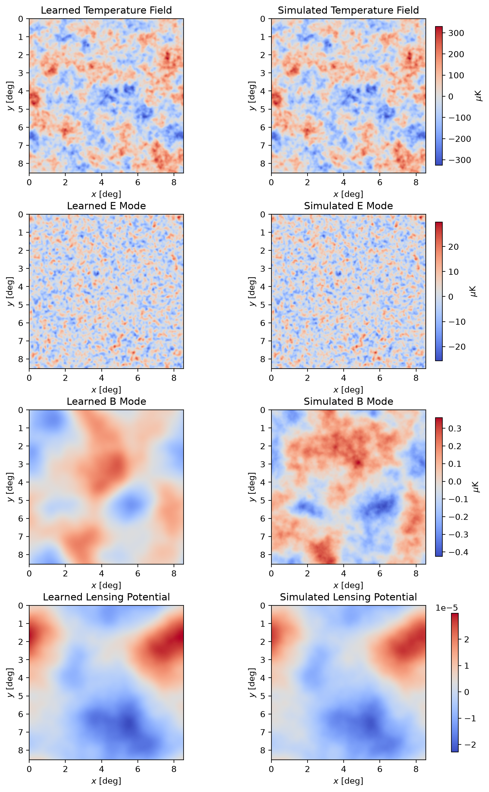
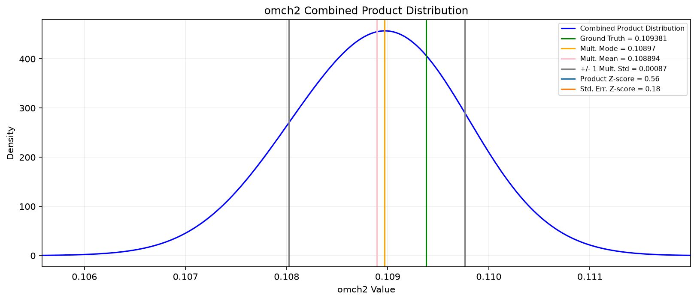
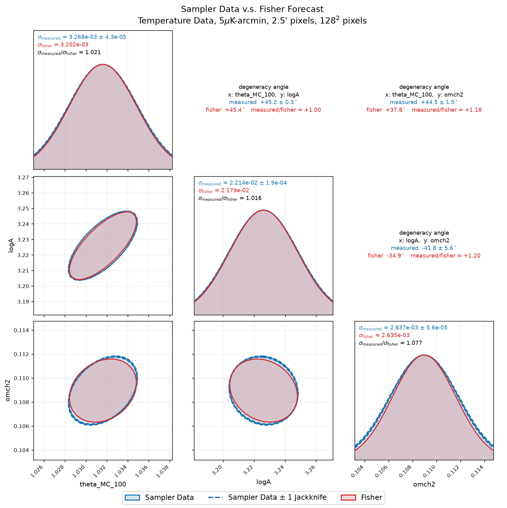

# Summary

[CMBLensing.py](https://github.com/zaneblood1/CMBLensing.py) [@CMBLensing.py] is the Python migration of [CMBLensing.jl](https://github.com/marius311/CMBLensing.jl) [@CMBLensing.jl], a Julia package for simulating Cosmic Microwave Background (CMB) fields, gravitational lensing, Maximum A Posteriori (MAP) estimates of CMB fields, and cosmological parameter sampling. Written in JAX [@jax2018github], most of its methods are Just-In-Time (JIT) compilable and run on CPU or GPU without special configuration. CMBLensing.py reproduces the full functionality of the original code and has been extensively tested for regressions. We have also extended the Julia sampler - which originally sampled the tensor-to-scalar ratio $r$ and the lensing potential band power $A_\phi$ [@Millea_2020] - to jointly sample any subset of 5 of the Lambda Cold Dark Matter (LCDM) cosmological parameters, taking a prior value on the optical depth to reionization $\tau_{\mathrm{reio}}$ due to its strong degeneracies with the other parameters. 

# Statement of Need

We migrated CMBLensing.jl into Python for better integration with other Python-based machine learning and inference projects, planned and ongoing, that we are developing. Calling CMBLensing.jl from Python previously required the ```juliacall``` [@PythonCall.jl] package and forced the user to write Julia inside a Python string, making debugging and iteration slow and tedious.

The LCDM parameter sampler is also a novel addition, expanding on the algorithm of [@Millea_2020] for jointly sampling $r$ and $A_\phi$. As far as we know, it is the first sampler to infer LCDM parameters directly at the field level from CMB maps with CMB lensing included in the forward model, jointly with the unlensed CMB and lensing potential. We have used it to jointly infer $\left[\log(A_s), \theta_{MC}, \Omega_c h^2\right]$ from lensed temperature maps at varying white noise levels, with the other LCDM parameters fixed at fiducial values.

# State of the Field

```map_joint``` computes MAP estimates of the unlensed CMB fields and the lensing potential from a noisy lensed data map (or set of maps); here we compare its run time and accuracy between the two implementations. Both packages contain other CMB analysis tools, such as ```lense_flow``` [@Millea_2019] for gravitationally lensing CMB fields and ```load_sim``` for synthetic data generation, but ```map_joint``` is a good all around benchmark since it brings many methods together into a single tool. The LCDM sampler is left to the **Research Impact Statement** section, since it is novel and cannot be directly compared between languages.

We ran ```map_joint``` on temperature plus polarization data and stored the cached run time per language, averaged over 10 input data maps and 10 trials per map, at several square map sizes. We list the experimental details in Table 1 and the results in Table 2. Even after caching, run time varies between map seeds of the same size, due to the variable line search which finds the optimal step size at each iteration. The two implementations agree within 1 standard deviation at smaller map sizes, but at the largest map tested Python is up to 4 times slower than Julia.


| Quantity | Value |
| --- | --- |
| Data | Temperature plus polarization (```IP```) |
| Map sizes | $128^2$, $256^2$, $512^2$, $1024^2$ pixels |
| Resolution | $2.5$ arcminutes per pixel |
| White noise level | $3$ $\mu K$ arcminutes in $T$, $\sqrt{2} \times 3$ $\mu K$ arcminutes in $E$ and $B$ |
| $1/f$ noise | $\ell$-knee $= 100$, $\alpha$-knee $= 3$ |
| Beam | None (FWHM $= 0$) |
| Mask | No pixel space sky mask. Fourier space low-pass held at unity through $\ell = 2950$, then a cosine ramp down to zero at $\ell = 3000$ |
| ```num_steps``` | $30$ |
| Data maps per map size | $10$ |
| Trials per data map | $10$ |
| Cached timing measurements per map size, per language | $100$ |

Table: Configuration of the ```map_joint``` run time and accuracy comparison experiment. Every data map is generated by the Julia ```load_sim``` implementation and handed to both language implementations, so the two are timed on bit-for-bit identical inputs.

| Map Size | Julia Average (s) | Python Average (s) | Python / Julia |
| --- | --- | --- | --- |
| $128^2$ | $99.46 \pm 41.7$ | $192.9 \pm 82.5$ | $1.94$ |
| $256^2$ | $550.4 \pm 342$ | $769.4 \pm 300$ | $1.4$ |
| $512^2$ | $2332 \pm 537$ | $4799 \pm 1440$ | $2.06$ |
| $1024^2$ | $6712 \pm 1450$ | $25700 \pm 3930$ | $3.83$ |

Table: Cached ```map_joint``` run times (mean $\pm$ standard deviation) versus map size for temperature plus polarization (```IP```) data.

Figure 1 below compares the accuracy of the two language implementations. We compare the average fractional difference between the Julia MAP estimates and the ground truth fields against the same quantity for Python. Only 4 series of lines are visible to the naked eye, so neither implementation is closer to the ground truth than the other; they agree to within numerical precision.


Figure 2 visually compares the Python output MAP estimates of the temperature and polarization fields as well as the lensing potential relative to the ground truth fields. There is little difference visible by eye. For those interested, plots of the cross correlation between Julia MAP Estimate x Ground Truth and Python MAP Estimate x Ground Truth are also available in the ``\experimental_results`` folder of the codebase. 



# Software Design

CMBLensing.py was migrated method by method, ensuring the two implementations produced outputs identical to within numerical precision for the same inputs. One of the first methods ported was ```lense_flow```, which iteratively lenses a CMB temperature or polarization field given the unlensed fields and lensing potential [@Millea_2019]. The Wiener filter, likelihood, and gradient methods followed, packaged into the main ```map_joint``` entry point.

Before implementing the new LCDM sampler, the machinery which jointly sampled $(r, A_\phi)$ was ported and confirmed to learn the same distributions between implementations for the same input maps. The step sampling those parameters was then swapped for one drawing LCDM parameter samples, leaving the neighboring field and lensing potential samplers untouched.

Unit tests in the ```\tests``` folder validate that corresponding methods in the two implementations produce identical outputs.

# Research Impact Statement

Besides making CMBLensing natively available in JAX, the sampling algorithm in ```sample_lcdm.py``` represents the first field-level joint inference of the LCDM parameters that includes lensing in the forward model. Other work, such as ```TODO```, has inferred these parameters from the CMB power spectra, but in this approach we use image data as the input to our algorithm. 

During development we confirmed that each of the 5 sampled parameters could be learned in isolation with the other 4 held at ground truth.  We also find that learning $\left[\log(A_s), \theta_{MC}, \Omega_ch^2\right]$ jointly is relatively easy for smaller temperature maps. The sampler could in theory be applied to larger subsets or the full set of 6 LCDM parameters, but in practice the map sizes needed to break the degeneracies and produce meaningful distributions with small widths become prohibitively large.

Table 3 outlines an experiment jointly inferring $\left[\log(A_s), \theta_{MC}, \Omega_ch^2\right]$ on 128 x 128 square pixel temperature maps.

| Quantity | Value |
| --- | --- |
| Data | Temperature only (```I```) |
| Map size | $128^2$ pixels |
| Resolution | $2.5$ arcminutes per pixel |
| White noise level | $5$ $\mu K$ arcminutes |
| $1/f$ noise | None |
| Beam | None (FWHM $= 0$) |
| Mask | None |
| Sampled parameters | $\log(A_s)$, $\theta_\mathrm{MC}$, $\Omega_ch^2$ |
| Parameters held at ground truth | $\Omega_bh^2$, $n_s$, $\tau_\mathrm{reio}$ |
| Ground truth $\log(A_s)$ | $3.218387$ |
| Ground truth $\theta_{MC}$ | $1.031732$ |
| Ground truth $\Omega_ch^2$ | $0.109381$ |
| Ground truth $\Omega_bh^2$ | $0.022386$ |
| Ground truth $n_s$ | $0.959814$ |
| Ground truth $\tau_\mathrm{reio}$ | $0.05$ |
| Search range, $\theta_\mathrm{MC}$ | $[0.9328, 1.1452]$ |
| Search range, $\log(A_s)$ | $[2.661635, 3.782861]$ |
| Search range, $\Omega_ch^2$ | $[0.085, 0.155541]$ |
| Chain starting points | Drawn at random inside the search ranges |
| $\theta$ step | Sequential 1 dimensional random walk Metropolis, with proposal widths $\theta_\mathrm{MC} = 3.5 \times 10^{-3}$, $\log(A_s) = 2.5 \times 10^{-2}$, $\Omega_ch^2 = 3 \times 10^{-3}$ |
| $\phi$ step | HMC with ```num_steps``` $= 10$ and ```step_size``` $= 0.05$ |
| $\phi$ initialization | Zero |
| Iterations with $\theta$ held fixed | $100$ |
| Data map realizations | $10$ |
| Sub-chains per data map | $5$ |
| Iterations per sub-chain | $6000$ |
| Burn-in discarded per sub-chain | $600$ samples |
| Thinning | By each sub-chain's integrated autocorrelation time |
| Convergence | Average Gelman-Rubin $\hat{R} < 1.05$ |

Table: Configuration of the joint $\left[\log(A_s), \theta_{MC}, \Omega_ch^2\right]$ sampling experiment run with ```sample_joint```.


After running the 10 map realizations and 5 sub-chains per map of Table 3 for 6000 iterations each, burn-in was removed, the sub-chains thinned by their integrated auto-correlation time and concatenated into 10 processed chains, one per map. A Gaussian kernel density estimate on each gives 10 "per-map" distributions, whose product is taken and re-normalized. Its mean is our best estimate, across all input data maps, of a given parameter's fiducial value. Figure 3 shows the result for $\Omega_ch^2$; plots for $\log(A_s)$ and $\theta_\mathrm{MC}$ are in the ```\experimental_results``` folder.



For the given noise level, map size, resolution, and sampler inputs we can compute a Fisher forecast for the expected lower bound on an individual map's learned uncertainty and compare it to the empirical widths. Figure 4 shows a triangle plot with Fisher in red and experimental results in blue. The experimental widths are only slightly larger, indicating our sampler performs close to optimally.



# Limitations

In theory our sampler could jointly infer all 6 LCDM parameters at once, but in practice the largest subset we could learn in testing was just 3. Many of the LCDM parameters are strongly degenerate, and breaking those degeneracies requires adding polarization data and increasing map size and resolution, all of which significantly slow down sampling. One iteration takes less than 3 seconds for 128 x 128 temperature-only maps with 4 `cpus-per-task` on Caltech's Resnick HPC [@caltech_hpc], but preliminary testing suggests a joint inference of just 5 of the parameters (excluding $\tau_\mathrm{reio}$) could require temperature plus polarization maps of at least 1024 x 1024 square pixels, at minimum a 192x increase in total run time. Running on GPU empirically gives at least a 4x speed increase, which cannot counteract the >192x slowdown projected.

Besides these time complexity problems, researchers should be aware of the many tuning knobs which must be adjusted to get well-behaved, non-pathological chains. For a given map size, resolution, and noise level, a pilot chain must be run before any large HPC experiment to confirm optimal acceptance rates: around 65% for the $\phi$ HMC step [@beskos2010optimaltuninghybridmontecarlo] and around 44% for each of the 1-D Metropolis-Hastings steps of the $N$ sampled LCDM parameters [@10.1214/aoap/1034625254]. Tuning is time intensive: the user must wait for the samples to burn in, record the acceptance rates, and adjust the knobs, repeatedly, until the optimal rates are achieved.

Perhaps the most troublesome limitation is the current mixing scheme we employ to decouple the field and lensing potential in our sampler. We use the mixing matrices $G$ and $D$ defined in [@Millea_2020] which are computed in terms of the noise covariance matrix. For these matrix definitions, low SNR yields good mixing, but also large widths in the computed distributions for the most difficult parameters to learn, e.g. $n_s$ or $\Omega_bh^2$. Learning these parameters would require a high SNR, but dropping the noise level diminishes the mixing matrices to the point that we either never burn in to the typical set or only ever sample the mode of the distribution. A mathematically justified mixing scheme decoupled from the experiment's noise would be a major area for future improvement, though we have been unable to find one.

# AI Usage Disclosure

Claude Code was used for code generation in parts of the code base and for preparation of this manuscript.  All AI generated code was reviewed by a human before being merged.

# Acknowledgements

The computations presented here were conducted in the Resnick High Performance Computing Center, a facility supported by Resnick Sustainability Institute at the California Institute of Technology.

# References
